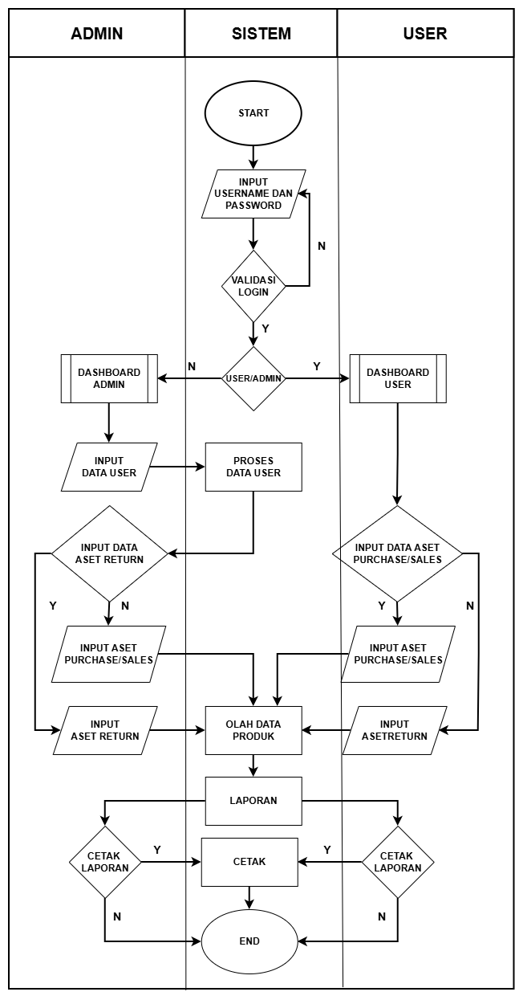
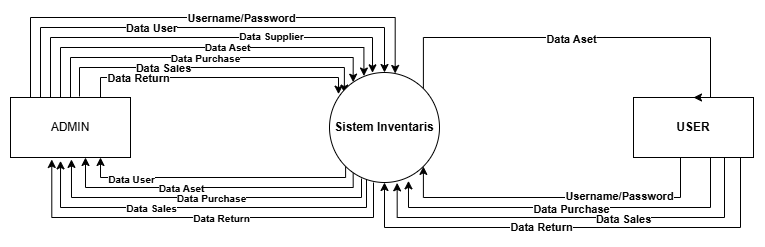
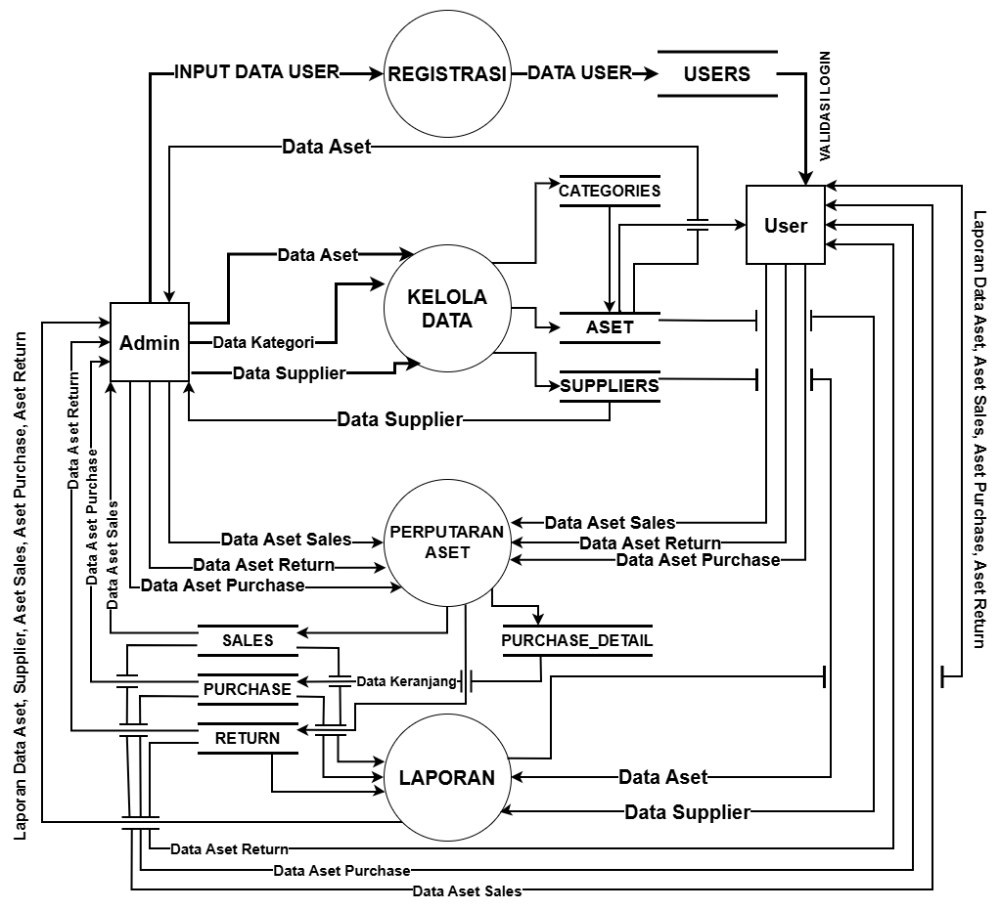
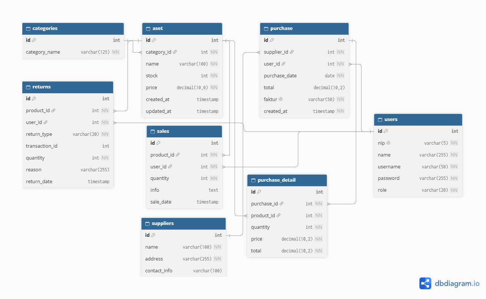

# Pemodelan Sistem & Arsitektur (System Modeling)

## Sistem Manajemen Inventaris Aset

Dokumen ini memuat penjelasan teknis dan perancangan alur kerja, aliran data, serta basis data dari sistem manajemen inventaris aset untuk mengoptimalkan proses pengelolaan aset secara digital guna mengurangi human error terutama pada proses dokumentasi aset.

---

## Flowchart Sistem
Diagram yang memberikan gambaran seluruh alur proses sistem, mulai dari proses validasi atau autentikasi akses masuk hingga hasil akhir dari aktivitas sistem berdasarkan hak akses (Admin & User).

Keterangan Alur :
- **Autentikasi Pengguna:** Pengguna memasukan username dan password yang diberikan oleh admin untuk divalidasi sistem dan diarahkan ke dasbor masing-masing (*role* Admin atau User).
- **Pengelolaan Data & Transaksi:** Admin bertugas membuat hak akses user, mengelola data master aset, data supplier, aset return, dan pembelian; sedangkan User/petugas menginputkan data purchase aset baru.
- **Monitoring & Pelaporan:** Kedua level hak akses dapat melakukan monitoring ketersediaan data aset barang serta mengunduh atau mencetak laporan log purchase, return, maupun ketersediaan aset.

## Diagram Konteks
Diagram yang memberikan gambaran aliran data masukan maupun keluaran secara makro antara sistem manajemen inventaris dengan entitas eksternal.

Entitas yang terlibat :

- **Admin (Supervisor):** Memberikan hak akses ke user, mengelola data aset, data supplier, serta memproses retur aset.
- **User (Staff):** Mengelola data purchase aset baru dan melakukan monitoring data ketersediaan aset.

## Data Flow Diagram (DFD) Level 1
Diagram lanjutan yang memberikan gambaran lebih rinci terkait dekomposisi proses fungsional utama pada sistem beserta elemen tempat penyimpanan data (*data store*).

Aktivitas / proses yang terlibat :

- **Proses 1.0 (Autentikasi):** Mengelola input data pengguna dan menyimpannya ke data users untuk keperluan validasi login.
- **Proses 2.0 (Kelola Data Master):** Mengelola data kategori, data aset, dan data supplier yang terhubung langsung dengan penyimpanan data categories, aset, serta suppliers.
- **Proses 3.0 (Perputaran Aset):** Mengelola transaksi perputaran aset yang mencakup data penjualan, pembelian, dan pengembalian, serta melibatkan tempat penyimpanan data sales, purchase, return, dan purchase_detail.
- **Proses 4.0(Pelaporan):** Menyajikan rekapitulasi laporan yang mencakup data aset, supplier, penjualan, pembelian, dan pengembalian berdasarkan data dari berbagai penyimpanan terkait.

## Relasi Basis Data
Diagram yang menggambarkan struktur tabel relasi di dalam basis data untuk mendukung integritas operasional inventaris aset.

Tabel Utama yang digunakan:

- **users:** Menyimpan data akun, NIP, kredensial, dan tingkat hak akses (*role*: `admin` atau `user`).
- **aset & categories:** Menyimpan master data aset barang beserta kategori, informasi stok, dan harga.
- **suppliers:** Menyimpan master data vendor atau pemasok aset.
- **purchase & purchase_detail:** Mencatat transaksi pengadaan dan pembelian aset baru dari supplier.
- **sales & returns:** Mencatat riwayat keluarnya aset serta mutasi pengembalian barang (*returns*).

